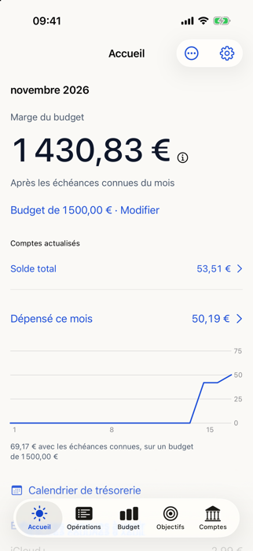
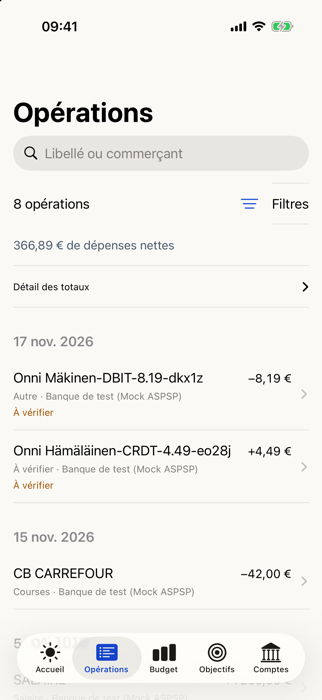
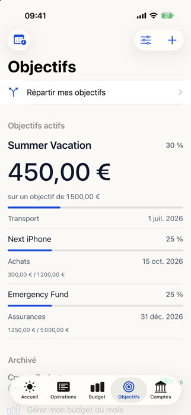
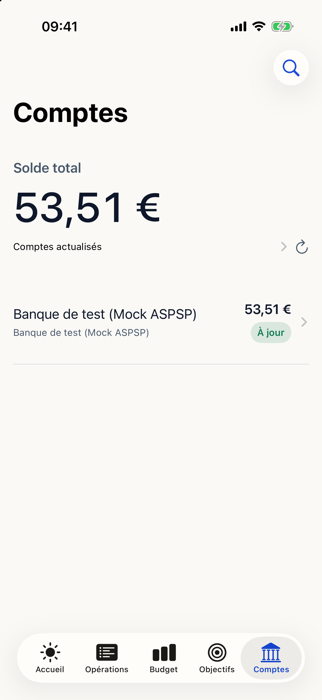

# Pécule

**Pécule est une application iPhone de budget : elle relie tes comptes bancaires, suit tes opérations et te dit ce qu'il te reste à dépenser ce mois-ci, sans que tes données quittent ton téléphone.**

Pensée pour une personne qui veut piloter son argent (budget du mois, échéances, objectifs d'épargne) plutôt que le subir. Les opérations sont stockées sur l'appareil ; la banque n'est contactée que par une petite passerelle qui ne garde aucune opération.

<p align="center">
  
  
  
  
</p>

<sub>Captures du simulateur avec des données de démonstration inventées (banque de test « Mock ASPSP »).</sub>

## Fonctions principales

- **Marge du budget** : un budget par mois, la marge restante après les échéances connues, le rythme de dépense et un calendrier de trésorerie.
- **Comptes bancaires (DSP2)** : liaison via [Enable Banking](https://enablebanking.com), soldes en temps réel, un an d'historique, détection des virements internes, indicateur de fraîcheur des données, actualisation en arrière-plan. Comptes manuels possibles.
- **Opérations** : recherche, filtres, catégorisation automatique, rapprochement avec les abonnements et les achats saisis.
- **Budget** : plafonds par catégorie, provisions (impôts, assurances annuelles), engagements et échéanciers, simulation d'un achat avant de le faire.
- **Objectifs d'épargne** : répartition de la marge entre plusieurs objectifs, réserve par objectif.
- **Analyse** : score de santé financière, rapport mensuel (PDF), export CSV, conseiller IA qui tourne sur l'appareil (Foundation Models) et ne reçoit que des agrégats.
- **Confidentialité** : écran masqué dans le sélecteur d'applications, base chargée avec copie automatique avant chaque migration, aucune donnée bancaire côté serveur.
- **Raccourcis Siri** (App Intents), français et anglais.

## Pile technique

| Partie | Technologies |
|---|---|
| App iOS (26+) | Swift 6, SwiftUI, SwiftData (6 versions de schéma, migration avec copie préalable), App Intents, Foundation Models, Swift Charts |
| Passerelle bancaire | Cloudflare Workers, TypeScript, Enable Banking, Sign in with Apple (socle multi-utilisateur) |
| Qualité | XCTest (572 tests unitaires, tests d'interface), Vitest (77 tests passerelle), GitHub Actions, XcodeGen |

Le code est organisé en services purs et testables (montants en `Decimal`, horloge et calendrier injectables) ; les écrans SwiftUI ne portent aucun calcul. Les anciens schémas SwiftData sont figés et protégés par un contrôle de CI (`tools/automation/check_frozen_schemas.sh`).

```
Pecule/            application iOS (App, Models, Services, Views, Components)
PeculeTests/       tests unitaires
PeculeUITests/     tests d'interface
gateway/           passerelle Cloudflare Worker (TypeScript)
tools/automation/  scripts de test et de CI
docs/              notes d'architecture
```

## Installation

Prérequis : macOS avec Xcode 26 ou plus, [XcodeGen](https://github.com/yonaskolb/XcodeGen) (`brew install xcodegen`).

```bash
xcodegen generate
open Pecule.xcodeproj
```

Choisis un simulateur iPhone et lance le schéma `Pecule`. Pour l'installer sur un appareil, remplace `DEVELOPMENT_TEAM` et le préfixe d'identifiant `com.nicolas` dans `project.yml` par les tiens.

Sans passerelle configurée, l'app fonctionne avec ses saisies manuelles. Pour tester la liaison bancaire sans banque réelle, lance l'app en mode démonstration (configuration Debug) avec `PECULE_AUTOMATION_DATA_MODE=seeded` : données inventées et banque simulée, rien n'est écrit sur le disque.

### Tests

```bash
tools/automation/test.sh unit      # tests unitaires
tools/automation/test.sh ui-core   # noyau des tests d'interface
```

### Passerelle bancaire (optionnel)

```bash
cd gateway
npm ci
npm test && npm run typecheck
```

Le déploiement exige un compte Cloudflare et une application Enable Banking (clé privée, identifiant d'application, jeton d'accès, sel de hachage, déclarés comme secrets Wrangler) ; voir les commentaires de `gateway/wrangler.toml`. L'adresse affichée sur les pages de confidentialité se fournit au déploiement : `DATA_PROTECTION_EMAIL=adresse npm run deploy:sandbox`.

## Licence

[GNU GPL v3](LICENSE).
